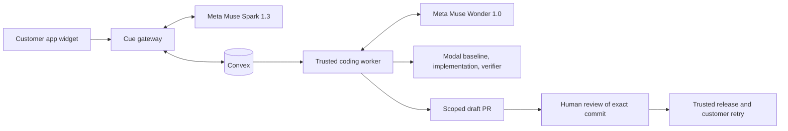

# Cue

Cue connects customer support to reviewed code changes. A customer reports a bug inside an app. Cue keeps the report, application context, diagnosis, proposed patch, and review evidence together.

This is the public Cue project for the Meta Global AI Developer Hackathon. Muse Spark 1.3 supports diagnosis and structured reasoning. Muse Wonder 1.0 uses scoped repository tools to propose a fix. A trusted supervisor runs checks in Modal and opens a draft pull request for human review.

## How the workflow fits together



Convex stores cases, knowledge, jobs, model receipts, reviews, and release evidence. The gateway handles operator authentication through WorkOS. The worker owns repository policy, GitHub operations, and independent checks. Model tools cannot approve or release their own changes.

The coding policy freezes the repository, base branch, allowed files, package directory, package manager, and verification commands. Baseline, implementation, and verification use separate Modal workspaces. Credentials stay in trusted services. Customer reports and repository content cannot change this policy.

## Current verification

At reviewed source [1136763](https://github.com/AvichalDwivedi2205/cue-fde/commit/1136763), checked November 3, 2026:

- 565 automated tests across 87 files, TypeScript, lint, and the production build passed. The production dependency audit reported zero known vulnerabilities at that check.
- Live provider checks verified Spark strict-schema JSON and a complete two-turn Wonder tool loop. Modal checks verified three separate workspaces and actual cancellation.
- The hosted web process serves the Meta configuration, and the IAM-protected cloud coding worker is online.
- The private customer baseline passed 238 tests and TypeScript. Its keyboard-deletion acceptance check still fails the reload assertion. The menu-deletion control passes.

The fresh widget report, Meta-generated private PR, human review, verified release, and customer retry remain **pending**. These component checks do not establish a completed customer journey. Follow the [demo plan](docs/meta-demo-plan.md) and [submission checklist](docs/meta-submission-checklist.md) for the remaining evidence.

## Run Cue locally

Use Node.js 22 or newer and npm. Start with the documented variables in [.env.example](.env.example):

```sh
npm ci
cp .env.example .env.local
```

Configure Convex and set the same randomly generated `CUE_DEMO_SECRET` in the server environment and Convex. Keep real credentials out of Git. `CUE_LOCAL_DEMO` is a loopback-only development bypass. Shared deployments require WorkOS authentication with that bypass disabled.

For the Meta configuration, set `META_API_KEY` on the server and select these models:

```dotenv
CUE_SUPPORT_MODEL=muse-spark-1.3
CUE_AGENT_MODEL=muse-spark-1.3
CUE_GROWTH_MODEL=muse-spark-1.3
CUE_CODING_MODEL=muse-wonder-1.0
```

The [Meta client](lib/meta.ts) validates returned model identity and usage. [Model routing](lib/model-config.ts) keeps support, staff reasoning, and coding selections explicit. Configure Meta explicitly for this workflow. Saved workspace settings override support and Growth environment defaults, so select Meta there too.

For isolated coding, set `MODAL_TOKEN_ID`, `MODAL_TOKEN_SECRET`, `CUE_MODAL_APP`, and `CUE_MODAL_IMAGE`. Inspect and run the [Modal image provisioner](scripts/modal-bootstrap.ts) once for your account. It prepares Node.js 22 and Bun 1.3.2. Authenticate GitHub with `gh auth login`, then bind an owned repository and fixed checks in **Setup**, under **Coding**.

Start Convex with `npm run dev:convex`. Set its server secret with `npx convex env set CUE_DEMO_SECRET`. In a second terminal, run `npm run dev` to start the web process and worker. Open `http://127.0.0.1:3000/cue#/inbox`.

Register an application and its exact allowed origins in **Setup**. Install the generated `/widget.js` snippet in that application, send a real widget message, verify the install, and activate the app. Shared widget installs need a reachable HTTPS `CUE_PUBLIC_URL`. Published knowledge and conversations belong to their registered application. See [company knowledge](docs/company-knowledge.md) and [platform boundaries](docs/platform-boundaries.md) for scope and authorization details.

## Review, preview, release, and retry

Engineering reviews the exact proposed commit. A changed commit requires a new review. Approval records a decision. The trusted deployment process still has to establish which code reached which environment.

The [preview helper](scripts/release-preview.ts) checks the approved private PR, frozen policy, clean checkout, and Vercel deployment identity. It creates previews only and records that browser acceptance is pending. Its project and scope come from operator configuration.

A release verifier records the deployed commit and acceptance evidence before Cue resolves a report. The customer's original action and reload test provide separate outcome evidence. A failed release check keeps the report open. Agent summaries alone cannot establish deployment or customer success.

## Review the public fixtures

LatchGrid is the existing private customer application used to test Cue's integration. Its canvas and private source are outside this public submission. The event work connects Meta routing and isolated coding execution to Cue's review and release controls. Public materials must separate those changes from the pre-existing customer app.

Reviewers can inspect and run the [Generic Notes fixture](demo/generic/README.md) without private source or customer access:

```sh
node demo/generic/test.mjs
```

Its seeded bug drops a note title, so the unchanged baseline fails with `title missing (expected saved)`. The [Bloom fixture](demo/bloom/README.md) provides another controlled regression. Treat both as test data. Fresh LatchGrid evidence has its own case, run, and release records.

## Run the automated checks

```sh
npm run test:backend
npm run typecheck
npm run lint
npm run build
npm audit --omit=dev
```

`npm run test:regression` targets the deliberately broken Bloom fixture and fails at its baseline. Live verifier and provisioning scripts can call providers or create records. Inspect their commands and configuration before use. Hosted acceptance requires its own provider and browser evidence.

## Build history and attribution

The first inspected Cue commit is [24af770](https://github.com/AvichalDwivedi2205/cue-fde/commit/24af7704de9f14e4771f792ad344803224459e07), dated October 27, 2026 in Git. The current Meta work extends that history. Event contributions, deployment, and eligibility require their own evidence.

Earlier October 10–13 development, verification, and neatHack submission claims were unsupported and are withdrawn. Old date-labelled files and footage are reference material. Use the corrected [provenance record](docs/repository-and-build-provenance.md), current source, and fresh Meta workflow evidence.
