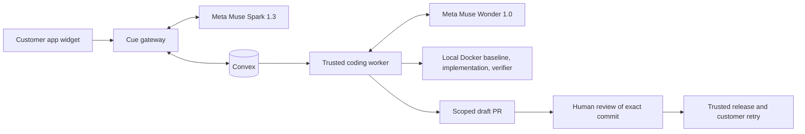

# Cue

Cue connects customer support to reviewed code changes. A customer reports a bug inside an app. Cue keeps the report, application context, diagnosis, proposed patch, and review evidence together.

This is the public Cue project for the Meta Global AI Developer Hackathon. Muse Spark 1.3 supports diagnosis and structured reasoning. Muse Wonder 1.0 uses scoped repository tools to propose a fix. A trusted supervisor runs checks in local Docker containers and opens a draft pull request for human review.

## How the workflow fits together



Convex stores cases, knowledge, jobs, model receipts, reviews, and release evidence. The gateway handles operator authentication through WorkOS. The worker owns repository policy, GitHub operations, and independent checks. Model tools cannot approve or release their own changes.

The coding policy freezes the repository, base branch, allowed files, package directory, package manager, and verification commands. Baseline, implementation, and verification use separate local Docker workspaces. Credentials stay in trusted services. Customer reports and repository content cannot change this policy.

## Current verification

At public checkpoint [02c5421](https://github.com/AvichalDwivedi2205/cue-fde/commit/02c5421), checked November 3, 2026, all 785 tests across 100 files, TypeScript, lint, and the production build pass. Lint has zero errors and six existing warnings. The hosted gateway runs the verified [8f3b3aa review UI](https://github.com/AvichalDwivedi2205/cue-fde/commit/8f3b3aa); the internal commit-provenance follow-up is deployed.

The real preview workflow is verified: an installed-widget report and screenshot received a Spark reply and classification, then Muse Wonder produced a scoped private draft PR in 17 completed calls. A fresh isolated verifier passed TypeScript, 238 default tests, and all eight protected acceptance checks before import. The patch changes one Canvas file with 49 added lines. Independent review found no new P1 or P2 issues. Human exact-commit approval and authenticated preview build receipts are recorded. A requested author correction preserved the exact tree and parent; original test provenance remains intact, with a separate approval for the replacement commit.

Browser checks confirm that Note keyboard and menu deletion stay saved after reload. Group-only deletion preserves unselected Notes; explicitly selecting a group and child deletes those two while retaining other Notes. Multi-selection deletion also persisted after normal workspace navigation and a fresh reload. This observes live timing, not controlled network latency. The exact grouped-child-to-outside-Note edge fixture has protected isolated-test coverage only. All synthetic test Notes and groups were removed.

The saved support thread rendered with correct branding in three current checks, including a fresh tab and reload, without DevTools. Earlier intermittent blank frames have no confirmed cause; these passing checks do not establish a source-level fix. No application security protections were changed.

The linked preview audit is recorded. Production release and the customer case remain pending; no customer-confirmed production resolution is claimed. The verified source is published on the public default branch. The video, personal eligibility confirmations, and submission form remain to complete. Modal is disabled after failed credit redemption; coding uses dedicated local Docker isolation and fresh verification.

See the [delivery evidence](docs/meta-delivery-plan.md), [three-minute demo plan](docs/meta-demo-plan.md), and [submission checklist](docs/meta-submission-checklist.md).

## Run Cue locally

Use Node.js 22 or newer and npm. Start with the documented variables in [.env.example](.env.example):

```sh
npm ci
cp .env.example .env.local
```

Configure Convex and set the same randomly generated `CUE_DEMO_SECRET` in the server environment and Convex. Keep real credentials out of Git. `CUE_LOCAL_DEMO` is a loopback-only development bypass. Shared deployments require WorkOS authentication with that bypass disabled.

For the Meta configuration, set `META_API_KEY` on the server and select these models:

```dotenv
CUE_SUPPORT_MODEL=muse-spark-1.3
CUE_AGENT_MODEL=muse-spark-1.3
CUE_GROWTH_MODEL=muse-spark-1.3
CUE_CODING_MODEL=muse-wonder-1.0
```

The [Meta client](lib/meta.ts) validates returned model identity and usage. [Model routing](lib/model-config.ts) keeps support, staff reasoning, and coding selections explicit. Configure Meta explicitly for this workflow. Saved workspace settings override support and Growth environment defaults, so select Meta there too.

For isolated coding, run a dedicated local Linux Docker context and build the trusted toolchain before repository source is present:

```sh
colima start --profile cue-code --cpus 2 --memory 4 --disk 16 --mount none --activate=false
docker --context colima-cue-code build -f Dockerfile.coding -t cue-coding-runtime:node24-bun1.3.2 .
```

Set `CUE_DOCKER_CONTEXT=colima-cue-code` and `CUE_CODING_IMAGE=cue-coding-runtime:node24-bun1.3.2`. Authenticate the trusted worker's GitHub account and set its `GH_TOKEN` server-side. Bind an owned repository and fixed checks in **Setup**, under **Coding**. The coding worker runs locally with `npm run coding:worker`; the Mac and Docker runtime must remain available while it processes jobs. It keeps external notification channels disabled. Model credentials and the Docker socket are never passed into repository check containers.

Start Convex with `npm run dev:convex`. Set its server secret with `npx convex env set CUE_DEMO_SECRET`. In a second terminal, run `npm run dev` to start the web process and worker. Open `http://127.0.0.1:3000/cue#/inbox`.

Register an application and its exact allowed origins in **Setup**. Install the generated `/widget.js` snippet in that application, send a real widget message, verify the install, and activate the app. Shared widget installs need a reachable HTTPS `CUE_PUBLIC_URL`. Published knowledge and conversations belong to their registered application. See [company knowledge](docs/company-knowledge.md) and [platform boundaries](docs/platform-boundaries.md) for scope and authorization details.

## Review, preview, release, and retry

Engineering reviews the exact proposed commit. A changed commit requires a new review. Approval records a decision. The trusted deployment process still has to establish which code reached which environment.

The [preview helper](scripts/release-preview.ts) checks the approved private PR, frozen policy, clean checkout, and Vercel deployment identity. It creates previews only and records that browser acceptance is pending. Its project and scope come from operator configuration.

A release verifier records the deployed commit and acceptance evidence before Cue resolves a report. The customer's original action and reload test provide separate outcome evidence. A failed release check keeps the report open. Agent summaries alone cannot establish deployment or customer success.

## Review the public fixtures

LatchGrid is the existing private customer application used to test Cue's integration. Its canvas and private source are outside this public submission. The event work connects Meta routing and isolated coding execution to Cue's review and release controls. Public materials must separate those changes from the pre-existing customer app.

Hosted operator views require authorized sign-in. The public repository and fixture checks are accessible without private customer source or workspace access.

Reviewers can inspect and run the [Generic Notes fixture](demo/generic/README.md) without private source or customer access:

```sh
node demo/generic/test.mjs
```

Its seeded bug drops a note title, so the unchanged baseline fails with `title missing (expected saved)`. The [Bloom fixture](demo/bloom/README.md) provides another controlled regression. Treat both as test data. Fresh LatchGrid evidence has its own case, run, and release records.

## Run the automated checks

```sh
npm run test:backend
npm run typecheck
npm run lint
npm run build
npm audit --omit=dev
```

`npm run test:regression` targets the deliberately broken Bloom fixture and fails at its baseline. Live verifier and provisioning scripts can call providers or create records. Inspect their commands and configuration before use. Hosted acceptance requires its own provider and browser evidence.

## Build history and attribution

The first inspected Cue commit is [24af770](https://github.com/AvichalDwivedi2205/cue-fde/commit/24af7704de9f14e4771f792ad344803224459e07), dated October 27, 2026 in Git. The current Meta work extends that history. Event contributions, deployment, and eligibility require their own evidence.

Earlier October 10–13 development, verification, and neatHack submission claims were unsupported and are withdrawn. Old date-labelled files and footage are reference material. Use the corrected [provenance record](docs/repository-and-build-provenance.md), current source, and fresh Meta workflow evidence.
